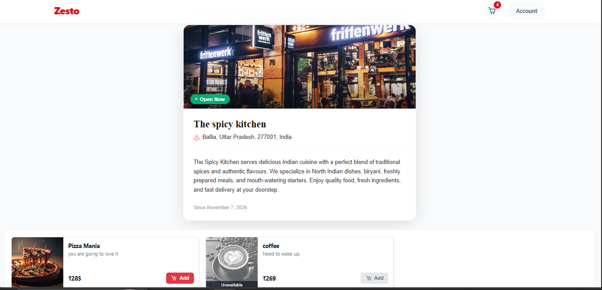
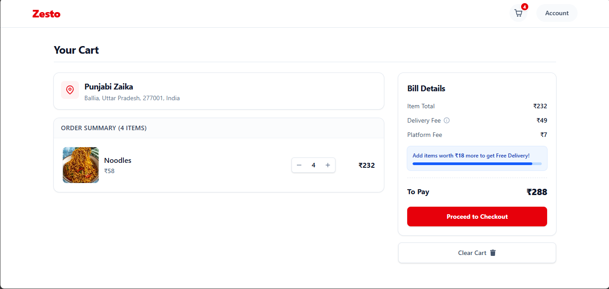
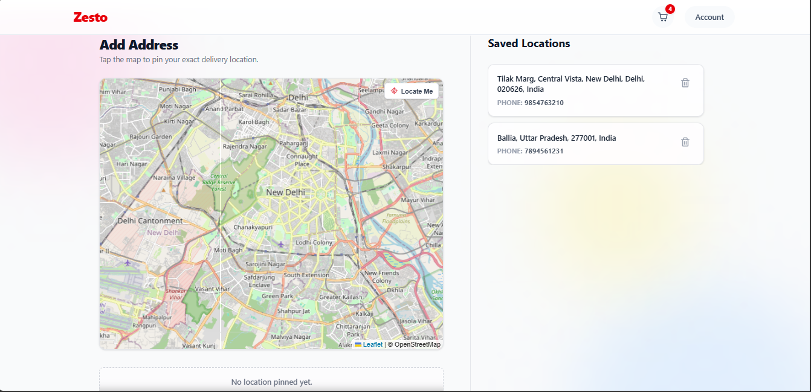
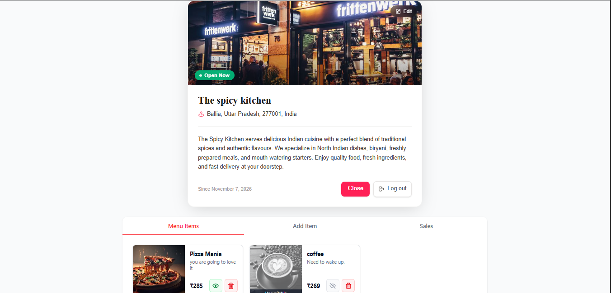
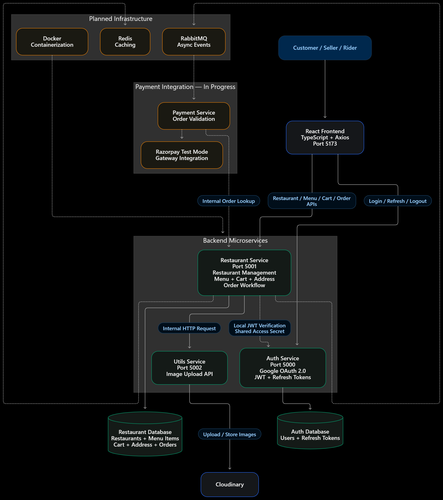

# ZESTO --- Role-Based Food Delivery Platform

ZESTO is a food delivery platform for **customers, restaurant owners
(sellers), and riders**. It is being developed with a React frontend and
a microservices-oriented backend. The current backend is split into
Auth, Restaurant, and Utils services.

> **Project status:** Work in progress. This README separates
> implemented features from ongoing work and planned infrastructure.

------------------------------------------------------------------------

## Contents

-   [Screenshots](#screenshots)
-   [Features and Development Status](#features-and-development-status)
-   [Architecture](#architecture)
-   [Technology Stack](#technology-stack)
-   [Repository Structure](#repository-structure)
-   [Key Engineering Decisions](#key-engineering-decisions)
-   [Getting Started](#getting-started)
-   [Environment Configuration](#environment-configuration)
-   [Running the Project](#running-the-project)
-   [API Overview](#api-overview)
-   [Roadmap](#roadmap)

------------------------------------------------------------------------

## Screenshots

Add your actual screenshots to `docs/screenshots/` and use these
filenames.

### Restaurant Discovery


### Restaurant Menu



### Shopping Cart



### Delivery Addresses



### Seller Dashboard



### System Architecture



------------------------------------------------------------------------

## Features and Development Status

### Implemented

**Authentication and authorization** - Google OAuth 2.0 using the
authorization-code flow. - JWT access and refresh tokens. - HTTP-only
cookies for token delivery. - Refresh-token rotation, with refresh-token
hashes stored in the Auth database. - Customer, seller, and rider
roles. - Protected routes using JWT verification and role/ownership
middleware. - Axios-based refresh handling on the frontend.

**Restaurant and menu management** - Create, edit, and retrieve
restaurant information. - Update restaurant open/closed status. -
Discover nearby restaurants using MongoDB geospatial queries. - Add menu
items with image upload. - Delete menu items and toggle item
availability. - Seller ownership checks for protected restaurant and
menu operations.

**Cart** - Add items, increment/decrement quantities, fetch cart
contents, and clear the cart. - One-restaurant-per-cart rule. - Cart
data references menu items and restaurants.

**Address and geospatial support** - Add, list, and delete customer
addresses. - Store locations as GeoJSON `Point` values. - MongoDB
`2dsphere` indexes for geospatial queries. - `$geoNear` for nearby
restaurant discovery and distance calculation. - GeoJSON coordinate
order: **\[longitude, latitude\]**.

**Shared utilities** - Cloudinary image-upload utility. - Restaurant
Service calls the Utils Service over HTTP for uploads.

### In Progress

-   **Order workflow:** Order creation and checkout logic, including
    address validation, cart retrieval, distance calculation with
    `$geoNear`, fee calculation, and order creation with item/address
    snapshots.
-   **Payment workflow:** Internal order lookup endpoint that returns
    order ID, amount, and currency after validating the internal service
    key and pending payment status.
-   **Razorpay:** Test-mode integration, gateway order creation, payment
    signature verification, and verified payment-status updates.
-   **Customer checkout and rider delivery:** End-to-end flows are still
    being completed.

### Planned

-   RabbitMQ for asynchronous events between services.
-   Redis for caching.
-   Docker and Docker Compose for containerized development.
-   Rider assignment, pickup, delivery tracking, and notifications.
-   Dedicated Payment, Rider, and Notification service boundaries as the
    system evolves.

------------------------------------------------------------------------

## Architecture

### Current services

``` text
                         React Frontend
                    Vite · TypeScript · Axios
                         localhost:5173
                               |
                     HTTP / httpOnly cookies
                               |
          +--------------------+--------------------+
          |                    |                    |
          v                    v                    v
     Auth Service        Restaurant Service      Utils Service
     localhost:5000      localhost:5001           localhost:5002
          |                    |                    |
          v                    v                    v
      Auth DB             Restaurant DB          Cloudinary
   User, RefreshToken   Restaurant, MenuItem,
                        Cart, Address, Order*
```

`*` Order functionality is under development and is not a complete
production lifecycle.

The Auth Service manages identity and token issuance. The Restaurant
Service owns restaurant, menu, cart, address, and developing order
functionality. The Utils Service handles image uploads to Cloudinary.

The Restaurant Service verifies access JWTs locally using the configured
shared access-token secret. It does not need to call the Auth Service
for every protected request.

### Planned architecture components

``` text
     Restaurant / Order Service
                |
             RabbitMQ
        (planned event broker)
          /      |       \
      Payment   Rider   Notifications
       (planned services / workflows)

       Redis cache       Docker Compose
          (planned)        (planned)
```

RabbitMQ, Redis, and Docker are roadmap items, not currently implemented
infrastructure.

------------------------------------------------------------------------

## Technology Stack

  -----------------------------------------------------------------------
  Category                Technologies            Status
  ----------------------- ----------------------- -----------------------
  Frontend                React, TypeScript,      Implemented
                          Vite, Axios             

  Backend                 Node.js, Express.js,    Implemented
                          TypeScript              

  Database / ODM          MongoDB, Mongoose       Implemented

  Authentication          Google OAuth 2.0, JWT,  Implemented
                          HTTP-only cookies       

  Geospatial queries      GeoJSON, MongoDB        Implemented
                          `2dsphere`, `$geoNear`  

  Image storage           Cloudinary              Implemented

  Payment gateway         Razorpay                In progress

  Message broker          RabbitMQ                Planned

  Caching                 Redis                   Planned

  Containerization        Docker, Docker Compose  Planned
  -----------------------------------------------------------------------

------------------------------------------------------------------------

## Repository Structure

``` text
ZESTO/
├── README.md
├── docs/
│   └── screenshots/
│       ├── 01-restaurant-discovery.png
│       ├── 02-restaurant-menu.png
│       ├── 03-cart.png
│       ├── 04-addresses.png
│       ├── 05-seller-dashboard.png
│       └── 06-architecture.png
├── Frontend/
│   ├── src/
│   │   ├── components/
│   │   ├── Context/
│   │   ├── pages/
│   │   ├── services/
│   │   └── types.ts
│   └── package.json
└── services/
    ├── auth/
    ├── restaurant/
    └── utils/
```

------------------------------------------------------------------------

## Key Engineering Decisions

### 1. Service-owned data

Each backend service owns its data and exposes functionality through
APIs. Services refer to users and other resources by identifiers rather
than performing cross-database joins.

### 2. Local JWT verification

The Auth Service issues JWTs containing the user identifier and role.
Protected services verify access tokens locally using the configured
shared secret, avoiding an Auth Service network call on every request.

### 3. HTTP-only cookies

Tokens are stored in HTTP-only cookies so frontend JavaScript cannot
directly read them. Cookie, CORS, and CSRF settings must be configured
carefully, particularly when frontend and backend are deployed on
different domains.

### 4. Refresh-token rotation

Refresh tokens are rotated and their hashes are stored in the Auth
database. The frontend coordinates refresh requests to avoid multiple
simultaneous refresh attempts.

### 5. Geospatial search

Restaurant and address locations use GeoJSON `Point` values and
`2dsphere` indexes. MongoDB `$geoNear` supports proximity-based
restaurant discovery and distance calculation. Coordinates must be
supplied as `[longitude, latitude]`.

### 6. One restaurant per cart

A cart is restricted to items from one restaurant at a time. This keeps
restaurant ownership, order preparation, and delivery-fee calculation
unambiguous.

### 7. Order snapshots

The order workflow is designed to preserve item names/prices and
delivery-address details as they were at checkout. Later menu-price or
saved-address changes should not rewrite historical order details.

------------------------------------------------------------------------

## Getting Started

### Prerequisites

-   Node.js and npm
-   MongoDB (local instance or MongoDB Atlas)
-   Google OAuth credentials
-   Cloudinary account for image uploads

### 1. Clone the repository

``` bash
git clone https://github.com/Rakshit099-g/ZESTO.git
cd ZESTO
```

### 2. Install dependencies

Install dependencies separately in each application/service directory:

``` bash
cd Frontend
npm install

cd ../services/auth
npm install

cd ../restaurant
npm install

cd ../utils
npm install
```

### 3. Configure environment variables

Create the environment files required by each service. Use the exact
variable names referenced by the current source code. See [Environment
Configuration](#environment-configuration).

### 4. Start the services

Run each command in a separate terminal. Check each service's
`package.json` for the available development script.

``` bash
# Frontend
cd Frontend
npm run dev
```

``` bash
# Auth Service
cd services/auth
npm run dev
```

``` bash
# Restaurant Service
cd services/restaurant
npm run dev
```

``` bash
# Utils Service
cd services/utils
npm run dev
```

The frontend Vite server typically runs at `http://localhost:5173`. The
documented backend ports are Auth `5000`, Restaurant `5001`, and Utils
`5002`; confirm the configured `PORT` values in your local environment.

------------------------------------------------------------------------

## Environment Configuration

Environment variable names can change as services evolve. Use the names
read by the current source code when creating local environment files.

  -----------------------------------------------------------------------
  Service                             Configuration required
  ----------------------------------- -----------------------------------
  Frontend                            Backend API base URL(s), such as
                                      the Vite API URL used by the Axios
                                      client

  Auth                                Port, MongoDB URI, Google OAuth
                                      client credentials, access-token
                                      secret, refresh-token secret,
                                      frontend origin

  Restaurant                          Port, MongoDB URI, access-token
                                      verification secret, frontend
                                      origin, Utils Service base URL,
                                      internal service key where required

  Utils                               Port, Cloudinary cloud name, API
                                      key, API secret

  Payment (when integrated)           Razorpay test/live key ID and
                                      secret, stored only on the backend
  -----------------------------------------------------------------------

------------------------------------------------------------------------

## Running the Project

Run the frontend and each backend service in separate terminals. The
exact scripts should be confirmed in each service's `package.json`.

  Application / Service     Local port Start command
  ----------------------- ------------ ---------------
  Frontend                        5173 `npm run dev`
  Auth Service                    5000 `npm run dev`
  Restaurant Service              5001 `npm run dev`
  Utils Service                   5002 `npm run dev`

------------------------------------------------------------------------

## API Overview

This is a high-level route overview based on the current architecture
notes. Confirm exact paths, HTTP methods, and request schemas in the
source route files before using them.

  -----------------------------------------------------------------------
  Service / Module        Route group /           Purpose
                          operations              
  ----------------------- ----------------------- -----------------------
  Auth                    Login, refresh, logout, Authentication and role
                          current user, role      management
                          update                  

  Restaurant              Create, edit, status,   Restaurant management
                          own restaurant, nearby  and discovery
                          list, single restaurant 

  Menu Items              Create, list by         Menu management
                          restaurant, delete,     
                          availability status     

  Cart                    Add, fetch, increment,  Cart operations
                          decrement, clear        

  Address                 Create, list, delete    Customer delivery
                                                  addresses

  Utils                   Image upload            Cloudinary upload
                                                  helper

  Order / Payment         Order creation and      Checkout and payment
                          internal payment lookup workflow
                          are under development   
  -----------------------------------------------------------------------

------------------------------------------------------------------------

## Roadmap

-   [x] Google OAuth and JWT authentication foundation
-   [x] Restaurant and menu management
-   [x] Cart operations and one-restaurant-per-cart rule
-   [x] Address management and GeoJSON geospatial support
-   [x] Cloudinary upload utility
-   [ ] Complete and test order lifecycle and checkout
-   [ ] Razorpay gateway order creation and payment signature
    verification
-   [ ] Verified payment webhook and idempotent payment updates
-   [ ] Rider assignment and delivery workflow
-   [ ] RabbitMQ event-driven communication
-   [ ] Redis caching
-   [ ] Docker and Docker Compose
-   [ ] Automated tests and deployment hardening

------------------------------------------------------------------------

## Author

**Rakshit Gupta**

-   GitHub: [Rakshit099-g](https://github.com/Rakshit099-g)
-   Project repository: [ZESTO](https://github.com/Rakshit099-g/ZESTO)

------------------------------------------------------------------------

*ZESTO is an actively developed portfolio project. Features marked as in
progress or planned are not represented as production-ready
implementations.*
